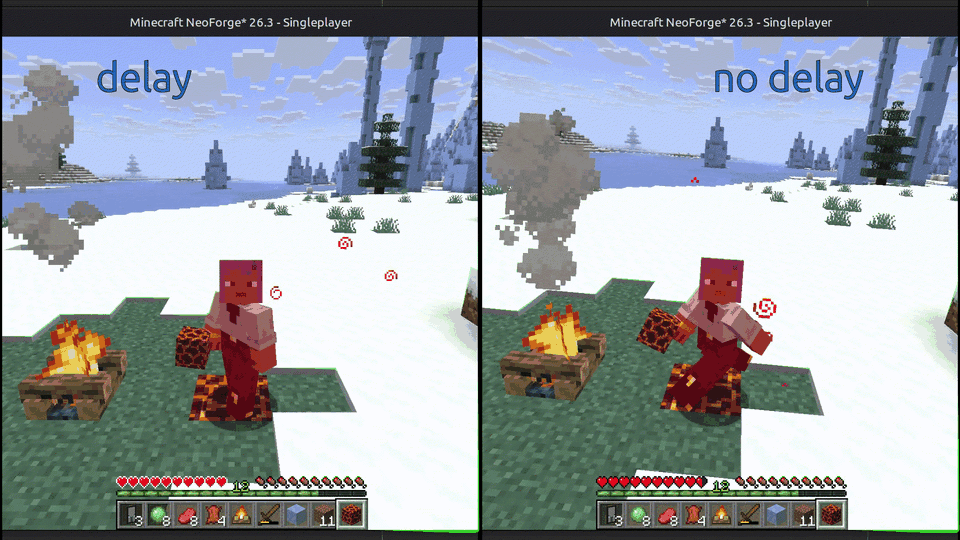
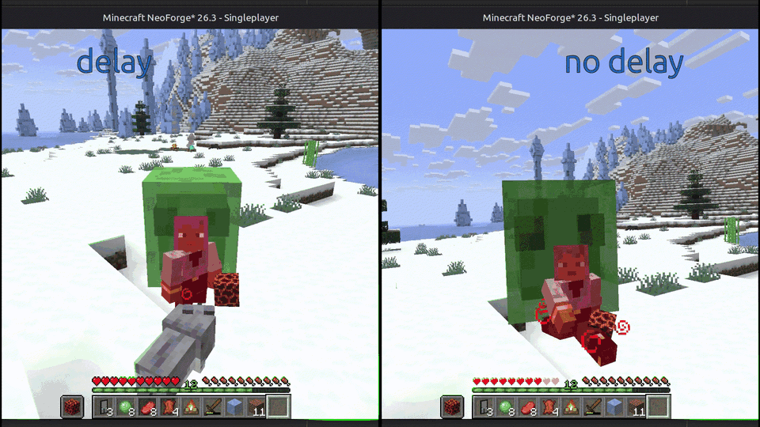
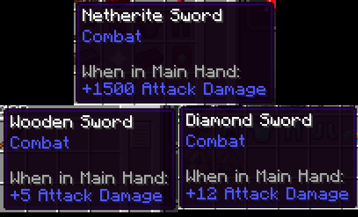

# No Attack Cooldown - Damage Delay
This mod removes the attack cooldown between consecutive attacks on mobs. Additionally, the invisible invulnerability period between taking damage is also removed.

## Additional Features
### Damage Delay Inclusion
This is an option that allows you to retain the invulnerability period for certain types of damage to prevent you from dying almost instantly, for example, when walking on a magma block.



### Cooldown for Entities
This option allows you to exclude certain entities from having their attack cooldown removed. This is intended to prevent, for example, slimes from killing you almost instantly.



### Remove Visual Indicator
This feature allows you to remove the attack cooldown indicator from your screen.

### Custom Damage Values
Allows you to set custom attack damage values for items defined in a configuration file.



**Usage:**
Open the configuration file located in your Minecraft folder (.../config/custom_damage_values.json). Then, add a new entry for each item. Each entry should follow this format:
```json
{
"<item>": <damage>,
"<item>": <damage>
}
```
Example:
```json
{
  "minecraft:wooden_sword": 5.0,
  "minecraft:diamond_sword": 12.0,
  "minecraft:netherite_sword": 1500.0
}
```

**NOTE**:
You have to restart Minecraft for the configuration changes to take effect because they modify the item registry.

## Download
- [Modrinth](https://modrinth.com/mod/no-attack-cooldown-damage-delay)
- [CurseForge](https://www.curseforge.com/minecraft/mc-mods/no-attack-cooldown-damage-delay)
